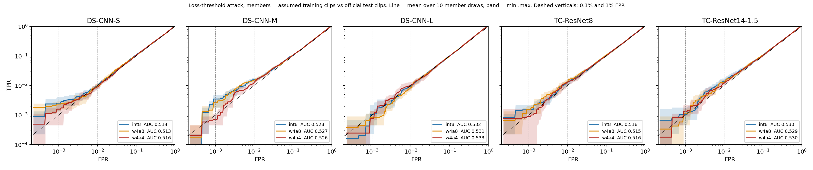
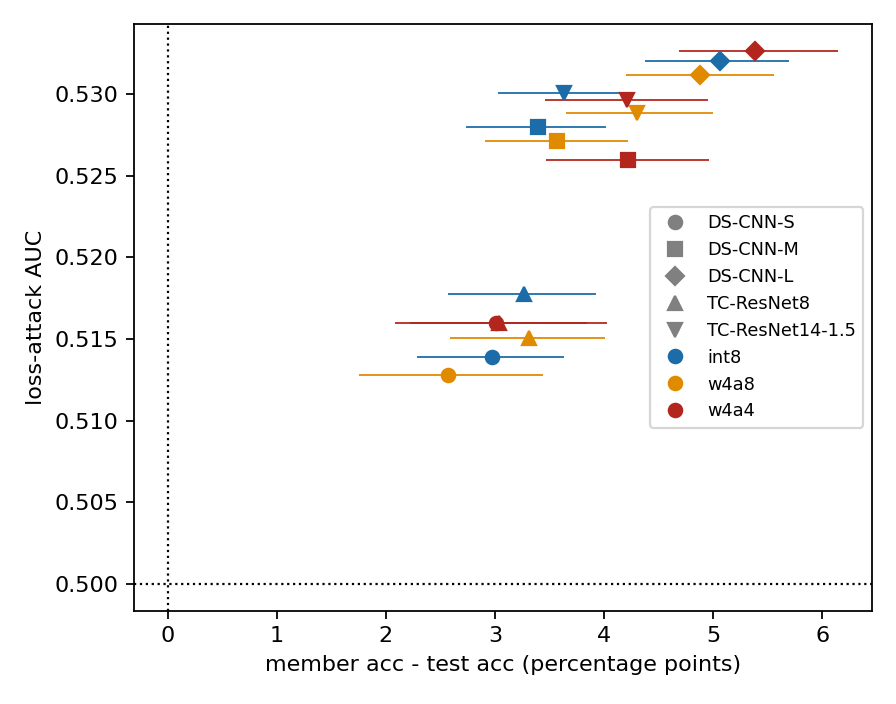

# Does int8 vs 4-bit post-training quantisation change membership-inference leakage of small keyword-spotting models?

Short answer from these runs: leakage is close to chance for all five models at all three bit-widths (loss-attack AUC 0.51 to 0.53), and I could not detect a difference between int8, w4a8 and w4a4. That statement is conditional on an assumed definition of "member" (see below), so read the caveats before the numbers.

The question comes from Bits for Privacy (https://arxiv.org/pdf/2512.15335), which studies this on images. I did not find prior work on KWS. That is all I am claiming about novelty; I did a limited search.

## Summary

- Setup: five small keyword-spotting networks (DS-CNN-S/M/L, TC-ResNet8, TC-ResNet14-1.5) in three versions each: int8, 4-bit weights with 8-bit activations (w4a8), and 4-bit weights and activations (w4a4). The 4-bit versions are post-training quantised, with no retraining.
- Attack: loss-threshold membership inference, plus confidence and modified-entropy variants, on the Speech Commands v0.02 test set (non-members) against clips from its training split (assumed members).
- Result: loss-attack AUC is 0.513 to 0.533 for all 15 model and bit-width combinations. Chance is 0.5. Differences between bit-widths are at most 0.003 AUC, which is inside the noise.
- AUC tracks each model's train-test accuracy gap across models (Spearman 0.91), not the bit-width.
- Main limit: which clips each model trained on is assumed from the standard recipe, not known. There is no fp32 baseline, and the attacks are simple ones, not LiRA.



## Contents

[What was done](#what-was-done) · [Sanity check](#sanity-check-on-membership) · [Results](#results) · [Limits](#limits) · [Related work](#related-work) · [Reproducing](#reproducing) · [Credits](#credits) · [Citation](#citation)

## What was done

Models: five small KWS networks from the cryptonite project (DS-CNN-S/M/L, TC-ResNet8, TC-ResNet14-1.5), each as an int8 model and two post-training 4-bit variants built from it (w4a8 = 4-bit weights, 8-bit activations; w4a4 = 4-bit weights and activations). The blobs and the bit-exact integer simulator (`qmodel.run_int`) come from cryptonite; there are no fp32 checkpoints, so there is no fp32 row. The res* models and dnn_l are left out (the res* 4-bit variants are broken by post-training quantisation).

Membership (assumed, not verified):
- Non-members: the official Speech Commands v0.02 test set, 4,890 clips, 12 classes. Silence (408 clips) is dropped from the attack because silence clips are generated and have no membership, leaving 4,482 non-members.
- Members: clips from the standard training split of v0.02 (files in neither `validation_list.txt` nor `testing_list.txt`; 84,843 clips), sampled without replacement and class-balanced to the test counts. 'unknown' members are drawn uniformly from the 25 non-keyword words.
- The exact training recipe of these models is lost. I am assuming they were trained on the standard split. If they were trained on something else (different split, extra data, augmentation of other clips) then "member" here is just "clip from the training split" and the attack measures less than it appears to.
- 10 independent member draws (seeds); every draw has 4,482 members, so AUC is computed on balanced sets.

Overlap of test set and training split (`results/raw/overlap_check.json`, from `scripts/01_build_pool.py`):
- 0 of the 4,482 non-silence test clips share a (word, file) name with the training split (all 4,482 are in `testing_list.txt`).
- 0 speaker ids in common: 239 test speakers, 2,112 training-split speakers.
- 0 test clips with byte-identical audio (md5 of the 16,000-sample int16 vector) in the training split.

So the non-members are disjoint from the assumed members. That says nothing about whether the models were really trained on the members.

Attacks (`scripts/mia.py`), all score = higher means member:
- loss: minus cross-entropy of the true label (loss threshold).
- conf: max softmax probability (label-free).
- ment: minus the modified entropy of Song and Mittal (2021), uses the true label.

Probabilities: softmax with temperature 1 over the 12 float logits that `run_int` returns (int32 accumulator times the output scale plus bias). This is a choice; a sensitivity check with T = 0.25 and 4 is in `results/raw/temperature_sensitivity.csv` and moves the loss AUC by at most about 0.01 (DS-CNN-L int8: 0.541 at T=0.25, 0.532 at T=1, 0.531 at T=4), nothing that changes a conclusion.

Metrics: AUC, TPR at 1% FPR and TPR at 0.1% FPR. TPR@FPR uses the (k+1)-th largest non-member score as threshold with k = floor(alpha n) and requires members to score strictly above it, so ties count against the attacker.

Uncertainty: 1,000 bootstrap resamples. In each resample the non-member indices are drawn once and shared by all seeds and bit-widths, each seed draws its own member indices (shared across bit-widths), and the statistic is the mean over the 10 seeds. The 95% interval is the 2.5 and 97.5 percentiles. Sharing indices across bit-widths makes the differences paired. "AUC sd over seeds" in the table is the spread of the per-seed point estimates. The intervals cover clip sampling, not other sources of error (assumed membership above all).

## Sanity check on membership

If the members really were training data, accuracy on members should be higher than on test clips. It is, for all 15 (model, bit-width) points, by 2.6 to 5.4 percentage points, and the bootstrap interval of the gap excludes 0 in every case (table below). So in this sense the check passed, and there is some difference between the assumed members and the test clips. Two cautions: (1) a gap does not prove memorisation, it could partly be a speaker or recording difference between the training split and the test set (the test speakers are all unseen, the member speakers are not), and I have no control that separates the two; (2) the gap is small for what are 95% accurate models, and the attacks below are correspondingly weak.

Accuracies here are over the 10 keyword classes plus unknown (no silence), so they differ a little from the numbers in the cryptonite json files, which include silence. As a check on the pipeline, the integer simulation reproduces the stored cryptonite predictions on the test set for all 15 models (the only differences: 1 clip for tc14_15 int8, 1 for tc14_15 w4a8, 1 for m w4a8).

## Results

Loss attack, mean over 10 member draws, 95% bootstrap interval in brackets. Gap = member accuracy minus test accuracy in percentage points.

| model | bits | test acc % | member acc % | gap (pp) [95% CI] | AUC [95% CI] | AUC sd over seeds | TPR@1% FPR % [95% CI] | TPR@0.1% FPR % [95% CI] |
|---|---|---|---|---|---|---|---|---|
| DS-CNN-S | int8 | 94.29 | 97.26 | 2.98 [2.28, 3.63] | 0.514 [0.505, 0.522] | 0.0046 | 1.0 [0.7, 1.4] | 0.3 [0.1, 0.4] |
| DS-CNN-S | w4a8 | 91.70 | 94.27 | 2.57 [1.75, 3.44] | 0.513 [0.504, 0.521] | 0.0037 | 0.9 [0.7, 1.3] | 0.2 [0.2, 0.3] |
| DS-CNN-S | w4a4 | 89.16 | 92.17 | 3.01 [2.08, 4.03] | 0.516 [0.507, 0.525] | 0.0038 | 0.9 [0.7, 1.3] | 0.2 [0.0, 0.3] |
| DS-CNN-M | int8 | 95.25 | 98.64 | 3.40 [2.73, 4.02] | 0.528 [0.519, 0.537] | 0.0038 | 1.6 [1.3, 1.8] | 0.3 [0.0, 0.6] |
| DS-CNN-M | w4a8 | 94.85 | 98.41 | 3.57 [2.90, 4.22] | 0.527 [0.518, 0.536] | 0.0038 | 1.5 [1.3, 1.8] | 0.3 [0.0, 0.6] |
| DS-CNN-M | w4a4 | 93.26 | 97.48 | 4.22 [3.47, 4.97] | 0.526 [0.516, 0.535] | 0.0036 | 1.3 [1.0, 1.8] | 0.1 [0.0, 0.3] |
| DS-CNN-L | int8 | 94.33 | 99.39 | 5.06 [4.38, 5.69] | 0.532 [0.522, 0.542] | 0.0036 | 1.0 [0.7, 1.3] | 0.1 [0.0, 0.2] |
| DS-CNN-L | w4a8 | 94.42 | 99.30 | 4.88 [4.21, 5.56] | 0.531 [0.521, 0.541] | 0.0032 | 0.8 [0.6, 1.4] | 0.1 [0.0, 0.1] |
| DS-CNN-L | w4a4 | 93.44 | 98.83 | 5.39 [4.69, 6.15] | 0.533 [0.523, 0.542] | 0.0028 | 1.0 [0.8, 1.4] | 0.1 [0.0, 0.3] |
| TC-ResNet8 | int8 | 94.80 | 98.07 | 3.27 [2.57, 3.93] | 0.518 [0.509, 0.526] | 0.0048 | 1.3 [0.9, 1.6] | 0.2 [0.1, 0.3] |
| TC-ResNet8 | w4a8 | 94.09 | 97.40 | 3.31 [2.59, 4.00] | 0.515 [0.506, 0.524] | 0.0055 | 1.3 [1.0, 1.7] | 0.2 [0.1, 0.4] |
| TC-ResNet8 | w4a4 | 92.97 | 96.01 | 3.04 [2.22, 3.85] | 0.516 [0.507, 0.525] | 0.0046 | 1.3 [1.0, 1.5] | 0.1 [0.1, 0.2] |
| TC-ResNet14-1.5 | int8 | 95.34 | 98.97 | 3.64 [3.03, 4.28] | 0.530 [0.521, 0.539] | 0.0025 | 1.3 [1.1, 1.8] | 0.1 [0.1, 0.4] |
| TC-ResNet14-1.5 | w4a8 | 94.44 | 98.74 | 4.30 [3.65, 5.00] | 0.529 [0.520, 0.538] | 0.0025 | 1.3 [1.1, 1.8] | 0.1 [0.0, 0.4] |
| TC-ResNet14-1.5 | w4a4 | 93.40 | 97.60 | 4.21 [3.46, 4.95] | 0.530 [0.520, 0.538] | 0.0025 | 1.2 [0.9, 1.6] | 0.1 [0.0, 0.3] |

Chance level is AUC 0.5, TPR@1% = 1%, TPR@0.1% = 0.1%.

- All loss-attack AUCs are between 0.513 and 0.533. The intervals exclude 0.5 narrowly, so there is a small signal under the assumed membership, but it is weak. TPR@1% FPR is 0.8% to 1.6% against a chance of 1%.
- The TPR@0.1% FPR column is based on about 4 non-members: with 4,482 non-members the threshold is the 5th highest non-member score, and 0.1% of 4,482 is 4.5. A TPR of 0.3% is about 13 members out of 4,482 against about 4 expected by chance. Treat that column as noise; the intervals say the same.
- int8 vs 4-bit: paired differences (`results/tables/paired_differences.md`) have point differences of at most 0.003 AUC in absolute value, with interval half-widths of 0.002 to 0.005. Of 90 paired comparisons (5 models x 2 contrasts x 3 attacks x 3 metrics) 3 have an interval excluding 0: TC-ResNet8 w4a8 vs int8 AUC for the three attacks, about 0.003 lower. These three are one effect seen through three correlated attacks, and with this many comparisons one such hit is not surprising. I do not read it as a bit-width effect. w4a4 is never distinguishable from int8. Conclusion: no meaningful difference detected, at this sample size, whose interval widths mean differences much below 0.005 AUC could not be resolved.
- The conf and ment attacks give the same picture (`results/tables/all_attacks.md`).
- ROC curves on log-log axes: `results/figures/roc_loglog.png` (mean over seeds, band is min to max). They sit on the diagonal except for a slight lift around 1e-3 to 1e-2 FPR; below 1e-3 the curves are steps of single clips.

Relation to the accuracy gap (`results/figures/gap_vs_auc.png`):

| subset | n | spearman | spearman p | pearson | pearson p |
|---|---|---|---|---|---|
| all 15 (model, bits) points | 15 | 0.914 | 0.0 | 0.856 | 0.0 |
| int8 only (5 models) | 5 | 1.0 | 0.0 | 0.741 | 0.1521 |
| w4a8 only (5 models) | 5 | 1.0 | 0.0 | 0.901 | 0.0366 |
| w4a4 only (5 models) | 5 | 0.8 | 0.1041 | 0.956 | 0.0108 |

Across the 15 points AUC rises with the gap (Spearman 0.91), but this is mostly a between-model effect: DS-CNN-L has the largest gap (about 5 pp) and the highest AUC, DS-CNN-S the smallest AUC. Within a model the gap hardly changes between bit-widths (changes are small against the bootstrap intervals; the largest is DS-CNN-M, whose w4a4 gap is 0.8 pp above its int8 gap, with overlapping unpaired intervals), which is consistent with AUC not moving. With 5 models per bit-width, and the 15 points not independent, these correlations are descriptive only.



## Limits

- Membership is assumed from the standard recipe, not verified. Non-member = test set, member = training split; any difference in distribution between them also counts as "leakage" in these numbers.
- No fp32 baseline: only int8, w4a8, w4a4 are compared, so I cannot say what quantisation did relative to full precision.
- Post-training quantisation only (no quantisation-aware training), with the specific PTQ procedure in cryptonite's `lowbit.py`.
- Five small models, one dataset (Speech Commands v0.02), one task.
- Loss-threshold / confidence / modified-entropy attacks, not LiRA or shadow-model attacks. Stronger attacks could find leakage these miss, and could show bit-width differences that these do not.
- Silence excluded from the attack.
- TPR@0.1% FPR rests on about 4 non-members.
- The MFCC mean/std used in training are not in the tree I was given and are not stored in the model json. I recovered them by regression of the cached cryptonite features on freshly computed raw MFCCs (`scripts/00_recover_norm.py`; maximum residual 7e-5 for the 'hello' front end and 2e-4 for 'tang'). This explains the few one-clip differences from the stored simulation mentioned above.
- The blob loader `load_blob` in cryptonite's `lowbit.py` ignores the per-op output clip range that the 4-bit variants store in the spare OpRec byte, so a w4a4 blob loaded with it runs with 8-bit activation ranges (about 96% agreement with the stored w4a4 simulation instead of 100%). `vendor/blob.py` reads that field back into `out_hi`; with it all 15 models match the stored simulation (modulo the 3 clips above). The source repo was not modified.

## Related work

The closest work I found studies quantisation and membership inference on images or tabular data, not speech: [Bits for Privacy](https://arxiv.org/pdf/2512.15335) (post-training quantisation methods on CIFAR and TinyImageNet), [Membership Inference Risks in Quantized Models](https://arxiv.org/pdf/2502.06567) (theory plus tabular and drug-discovery data) and [Famili and Lao](https://www.ncbi.nlm.nih.gov/pmc/articles/PMC10538103/) (quantisation as a defence, on ResNet). Membership inference on audio models exists without compression ([audio MIA with 1D CNNs](https://ar5iv.labs.arxiv.org/html/1911.01888), [VoxGuard](https://arxiv.org/html/2509.18413v2)). I read their abstracts, not the full papers, and I only ran a limited search, so there may be keyword-spotting work I missed. The contribution here is small: the same question on small keyword spotters, comparing the int8 and 4-bit models I already had.

## Reproducing

```
pip install numpy pandas scipy matplotlib torch          # see requirements.txt
data/speech_commands_v0.02.tar.gz    # 2,428,923,189 bytes
data/test_set/                       # official v0.02 test set (12 class folders)
./run_all.sh                         # SEEDS=10 BOOT=1000 by default
```

`run_all.sh` checks the archive size, extracts it, installs a matching torchaudio into `.pylib` (the copy in cryptonite's `.cache/pylib` is built for torch 2.1 and does not load with torch 2.11), then runs `scripts/01_build_pool.py`, `02_logits.py`, `03_attack.py`, `04_tables_figs.py`. On my Mac the logits step takes about 10 minutes and the bootstrap a few minutes. Timings here are simulator timings on a laptop and say nothing about the board. `scripts/00_recover_norm.py` needs the cryptonite `.cache` and its output (`assets/norm_*.json`) is committed, so it is not part of `run_all.sh`.

Layout: `assets/` model blobs, json, stored simulation outputs, manifest, recovered normalisation; `vendor/` copies of cryptonite's `qmodel.py`, `frontend.py` and an edited loader; `scripts/`; `results/raw/` per-seed metrics, paired differences, accuracy gaps, member draws, bootstrap draws, overlap check, logs; `results/tables/` csv and md; `results/figures/`.

## Credits

- Speech Commands dataset: Pete Warden, "Speech Commands: A Dataset for Limited-Vocabulary Speech Recognition", arXiv:1804.03209 (v0.02 release, CC BY 4.0).
- Models, quantised variants, integer simulator and front end: the cryptonite project, copied read-only into `assets/` and `vendor/`.
- Bits for Privacy, https://arxiv.org/pdf/2512.15335.
- Attacks: Yeom et al. 2018 (loss threshold); Song and Mittal 2021 (modified entropy).

## Citation

```
@misc{kws_quant_privacy,
  author = {ankushachwani},
  title  = {Does int8 vs 4-bit post-training quantisation change membership-inference leakage of small keyword-spotting models?},
  year   = {2026},
  howpublished = {\url{https://github.com/ankushachwani/kws_quant_privacy}}
}
```
